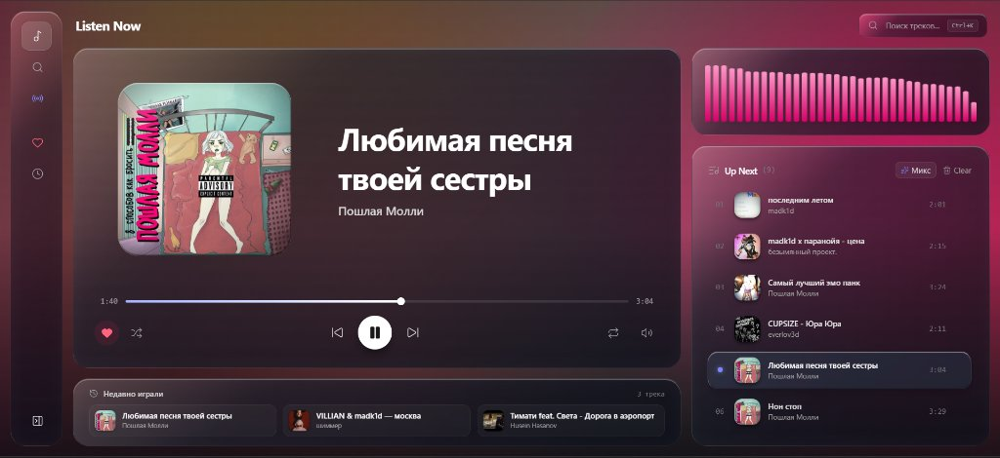
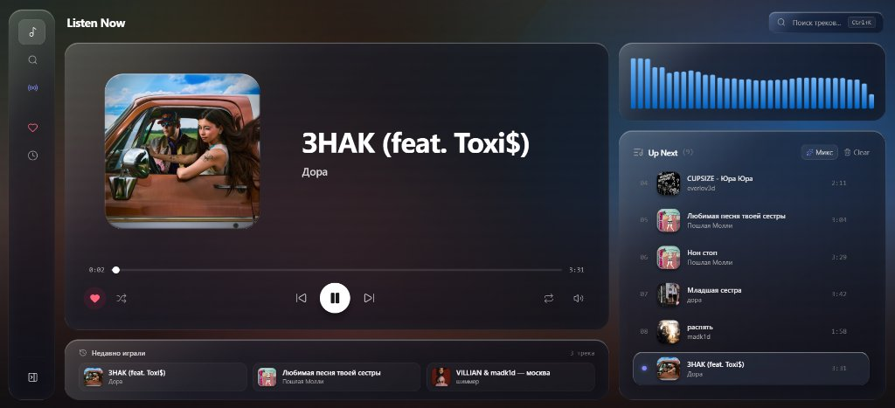
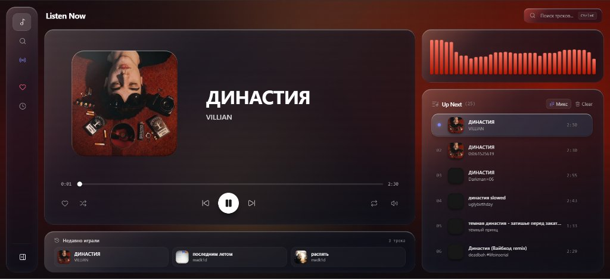
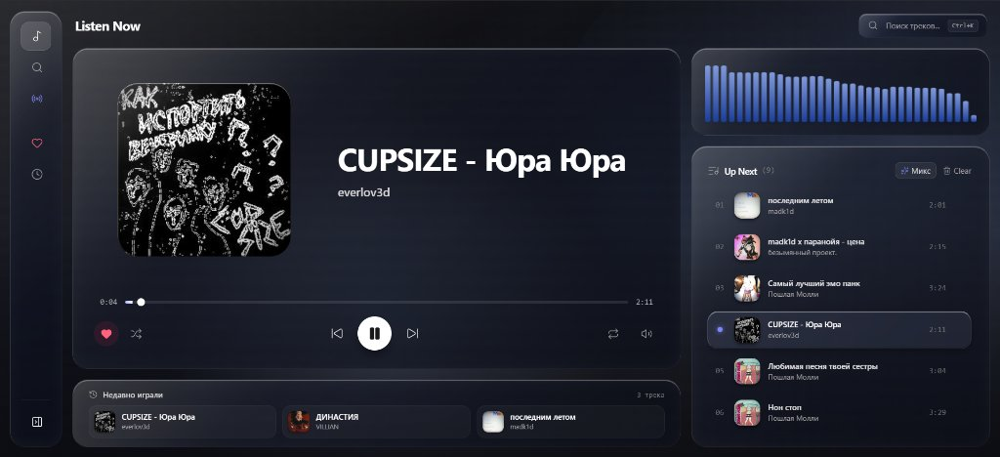

# Sonora

Веб-плеер с каталогом SoundCloud, умным персональным радио **MildWave**, 5-полосным эквалайзером, 3D-стерео и адаптивным стеклянным интерфейсом, меняющим тему под цвета текущей обложки.

---

## Скриншоты

| Розовый амбиент | Синий амбиент |
| :---: | :---: |
|  |  |
| **Янтарный амбиент** | **Тёмный монохром** |
|  |  |

---

## Возможности

- **Каталог SoundCloud v2**: полнотекстовый поиск (`Ctrl+K`), прямое воспроизведение треков и стриминг (Progressive MP3 и HLS) через собственный прокси с поддержкой перемотки (HTTP 206 Range).
- **Умное радио MildWave**: автоматическая генерация персонального потока на основе лайков и истории прослушиваний. Кнопка «Микс» для мгновенной пересборки очереди.
- **Студийный микшер и эквалайзер**:
  - 5-полосный графический эквалайзер (60 Hz, 250 Hz, 1 kHz, 4 kHz, 12 kHz) с готовыми пресетами.
  - Bass Boost, панорама (L/R) и входной предусилитель.
  - Пространственный алгоритм **3D Stereo** (фазовое расширение звукового поля без моно-схлопывания).
- **Адаптивный дизайн Liquid Glass**:
  - Динамический фон с мягким размытием, автоматически извлекающий палитру из обложки трека.
  - Живой спектральный анализатор с монохроматическим градиентом в тон обложки.
  - Выделение активного трека 3D-обводкой Waterfall Glass.
- **Полная автономность**: автоматический поиск и ротация актуального `client_id` SoundCloud, сохранение сессии, очереди и лайков в локальном хранилище.

---

## Быстрый старт

### Вариант 1. Запуск десктопного приложения Sonora (Electron)

Запустите готовый скрипт в корне:
```bat
start-desktop.bat
```
Либо напрямую запустите бинарник:
```
frontend\dist_electron\win-unpacked\Sonora.exe
```

---

### Вариант 2. Запуск в браузере в один клик (Windows)

Запустите скрипт в корне проекта:
```bat
start.bat
```
или в PowerShell:
```powershell
.\start.ps1
```
После запуска откройте в браузере: **http://localhost:5173**

---

### Вариант 3. Ручной запуск

#### 1. Бэкенд (Python 3.10+)
```powershell
cd backend
python -m venv .venv
.\.venv\Scripts\activate
pip install -r requirements.txt
$env:PYTHONPATH = (Get-Location).Path
python run.py
```
> Бэкенд запустится на `http://127.0.0.1:8000`

#### 2. Фронтенд (Node.js 18+)
```powershell
cd frontend
npm install
npm run dev
```
> Фронтенд запустится на `http://127.0.0.1:5173`

---

## Архитектура и стек

| Слой | Технологии |
| :--- | :--- |
| **Backend** | Python 3.14, FastAPI, HTTPX, Uvicorn |
| **Frontend** | React 19, TypeScript, Vite, Tailwind CSS, Lucide Icons, Hls.js |
| **Audio DSP** | Web Audio API (BiquadFilterNode, StereoPannerNode, DelayNode, AnalyserNode) |

---

## API Эндпоинты

| Метод | Путь | Описание |
| :--- | :--- | :--- |
| `GET` | `/api/health` | Проверка доступности API и валидности `client_id` |
| `GET` | `/api/search?q={query}&limit=20` | Поиск треков в каталоге SoundCloud |
| `GET` | `/api/tracks/{id}` | Метаданные трека |
| `GET` | `/api/stream/{id}/info` | Определение формата стриминга (`progressive` / `hls`) |
| `GET` | `/api/stream/{id}/raw` | Аудио-прокси с поддержкой Range-запросов (HTTP 206) |
| `GET` | `/api/stream/{id}/playlist.m3u8` | Проксированный HLS-манифест |
| `POST` | `/api/mildwave/recommend` | Рекомендательный алгоритм персонального радио |

---

## Тестирование системы

Автоматический сквозной тест бэкенда (проверка поиска, стриминга, ротации ключа и рекомендаций):
```powershell
python backend/test_system.py
```
